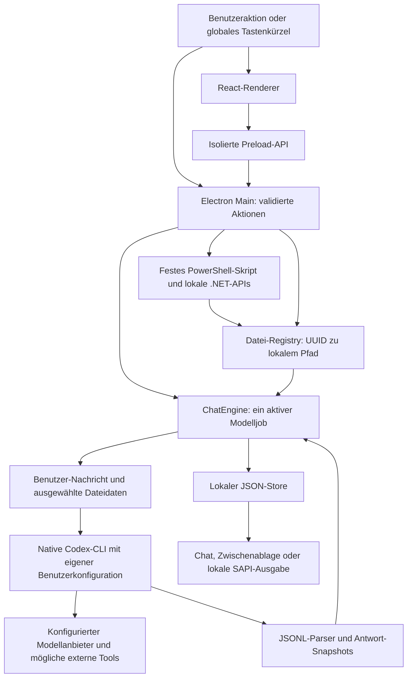

# Architektur und Vertrauensgrenzen

Dieses Dokument beschreibt den tatsächlich implementierten Stand, nicht alle Wünsche aus der ursprünglichen Projektskizze. Bedienung und Standardwerte stehen im [README](../README.md); die manuelle Abnahme in der [Windows-Testcheckliste](WINDOWS-TEST-CHECKLIST.md).

## 1. Technologieentscheidung

- **Electron** beherbergt einen Main-Prozess mit Node-APIs, ein isoliertes Preload und einen sandboxed Chromium-Renderer.
- **React, TypeScript, Vite und Tailwind CSS** bilden die Oberfläche; Lucide liefert Icons, `react-markdown` mit GFM und Highlighting die Antwortdarstellung.
- **Node-Subprozesse** starten die bereits vorhandene native Codex-CLI. Das Overlay ist weder ein eigener Modellserver noch ein `app-server`-Client.
- **Windows PowerShell 5.1 / .NET Framework 4.8** stellen Screenshot- und SAPI-Funktionen bereit. Der Skriptinhalt ist fest mitgeliefert; benutzerabhängige Werte laufen als JSON über stdin.
- **PDF.js** extrahiert PDF-Text lokal. Sein unterstützter Node-Ladepfad benötigt eine funktionsfähige passende native `@napi-rs/canvas`-Installation, obwohl die App keine PDF-Seiten rendert.

Tauri v2/Rust war bevorzugt. Da die Rust-Toolchain in der Entwicklungsumgebung nicht verfügbar war, wurde pragmatisch ein ausführbarer Electron-/TypeScript-Stack gewählt. Das ist eine bewusste Abweichung, keine Behauptung einer Tauri-Implementierung. Ziel sind Windows 10/11 x64; der bisher verwendete Host ist Windows 11 x64, keine Windows-10-Abnahme.

## 2. Komponenten

| Datei/Bereich | Zuständigkeit |
| --- | --- |
| `shared/types.ts`, `shared/defaults.ts` | IPC-/Domänentypen, vier Modi und Standardwerte |
| `src/App.tsx`, `src/Chat.tsx`, `src/Sidebar.tsx` | Fensteroberfläche, Unterhaltung, Anhangaktionen und Verlauf |
| `src/useOverlay.ts`, `src/model.ts` | Bootstrap/Event-Puffer, Entwürfe, Navigation und vollständige Antwort-Snapshots |
| `src/Settings.tsx` | Einstellungsentwurf, explizites Speichern, Shortcut-Recorder, CLI-/Stimmtests |
| `electron/preload.ts` | eingefrorene `window.overlay`-API; `invoke` und kontrollierte Ereignisabonnements |
| `electron/main.ts` | App-Lebenszyklus, Fenster/Tray, IPC-Vertrauen, Datei-/Capture-Aktionen, Clipboard, Login-Start und Shutdown |
| `electron/chat.ts` | genau ein Modelljob, Vorbereitung, Session-ID, Persistenz, Abschlussausgaben, Abbruch |
| `electron/prompt.ts` | Zusammenbau einer Benutzer-Nachricht mit Moduspräferenzen und gekennzeichneten Dateidaten |
| `electron/codex.ts` | native CLI-Suche, Argumente, stdin, Statusprüfung, Zeit-/Bytegrenzen, Prozessbaum-Abbruch |
| `electron/protocol.ts` | begrenzter UTF-8-/JSONL-Parser, Session- und Antwort-Snapshots |
| `electron/config.ts`, `electron/hotkeys.ts` | strikte Main-Validierung, kanonische Kürzel, konfliktbehandelte Registrierung |
| `electron/store.ts` | validierte JSON-Persistenz mit atomarer Dateiersetzung und Quarantäne beschädigter Daten |
| `electron/files.ts` | Registry mit UUIDs und ausschließlich dort gehaltenen Originalpfaden; Text/PDF-/Bildprüfung und Freigabe |
| `electron/windows.ts`, `resources/windows.ps1` | begrenzte versteckte native Prozesse, Capture, Stimmen, Vorlesen und Aufräumen |
| `resources/installer.nsh` | Entfernen des eigenen HKCU-Autostarteintrags bei Deinstallation |



Der Renderer erhält Anhang-Metadaten und gegebenenfalls Vorschau-Daten-URLs, keine Registry-Dateipfade. Beim Drop bestimmt das Preload den Pfad echter Electron-`File`-Objekte und übergibt ihn dem Main-Prozess. Beim späteren Senden werden ausschließlich registrierte UUIDs verwendet.

## 3. Start, Fenster und Einstellungen

`main.ts` setzt `app.setName('Codex Overlay')` vor dem normalen Zugriff auf `app.getPath('userData')`. Standard ist unter Windows **`%APPDATA%\Codex Overlay`**; dieser Pfad wurde in einem datenreinen echten Electron-Main-Prozess geprüft. Ein explizites `CODEX_OVERLAY_DATA_DIR` wird vorher für isolierte Tests übernommen.

Nach `whenReady()` lädt der Store Einstellungen, Fenstergrenzen und Verläufe, bereinigt alte eigene Capture-Dateien und erzeugt Dienste, Fenster, Tray und Hotkeys. Das Single-Instance-Lock verhindert einen zweiten normalen App-Prozess mit konkurrierender Registry. Ein zweiter Start aktiviert das vorhandene Fenster.

Das Overlay ist rahmenlos, verschiebbar und in der Größe veränderbar. Ausgeblendete Fenster folgen bei Bedarf dem Monitor unter dem Mauszeiger; ein sichtbares Fenster wird nicht ungefragt auf einen anderen Monitor verschoben. Nicht mehr sichtbare gespeicherte Positionen werden beim Start korrigiert. Tray, Vordergrundmodus und Fokusverlustverhalten sind Einstellungen, keine globale Änderung fremder Fenster.

Einstellungen sind ein Renderer-Entwurf bis zum Speichern. `config.ts` akzeptiert nur bekannte, vollständig typisierte Felder. Das Main-Backend ist maßgeblich, auch wenn UI-Hinweise weiter gefasst sind: etwa Zeitlimit mindestens 15 Sekunden, keine leeren globalen Shortcuts und keine Windows-/Meta-Kombinationen. Ein bestehender absoluter Workspace wird vor dem Speichern geprüft. Änderungen von Hotkeys/Login-Start werden bei Fehlern soweit möglich zurückgerollt; ein Fehler bei der Wiederherstellung wird gemeldet statt als Erfolg ausgegeben.

Autostart verwendet nur in der gepackten App `app.setLoginItemSettings()` mit der eigenen EXE und `--hidden`. Es gibt keinen Windows-Dienst. Der Installer entfernt den eigenen Run-Eintrag bei der Deinstallation; Appdaten werden standardmäßig aufbewahrt.

## 4. Anfrage und Session-Fortsetzung

1. `ChatEngine.start()` validiert Modus, Unterhaltung, Nachricht und maximal 50 eindeutige Anhang-IDs. Während Vorbereitung oder Ausführung ist kein zweiter Modelljob erlaubt.
2. `FileService.prepare()` liest ausgewählte Dateien erneut und prüft Größe, Format und Identität. Text/PDF wird als Text geliefert; Bilder bleiben absolute lokale Pfade.
3. `buildPrompt()` erzeugt **eine Benutzer-Nachricht**: Moduspräferenzen, aktuelle Benutzeranfrage und separat markierter unvertrauenswürdiger Dateitext. Benutzeranfrage und Präferenzen haben eigene Budgets; der Gesamtprompt ist auf 200.000 UTF-16-Codeeinheiten begrenzt. Interne Kürzung wird ausdrücklich mit einer Kürzungsnotiz markiert, nicht als vollständiger Inhalt ausgegeben.
4. Benutzer- und ausstehende Assistentennachricht werden gespeichert. Danach startet die native CLI mit stdin für den Prompt und einer Argumentliste ohne Shell.
5. Für Folgefragen wird die von `thread.started` gelieferte Session-ID mit `exec resume` verwendet. Das Overlay spielt nicht eigenständig den gesamten JSON-Verlauf als neuen Prompt ab. Fehlt der Codex-Thread oder ist er nicht kompatibel, wird der CLI-Fehler sichtbar; es gibt keinen behaupteten verlustfreien Resume-Fallback.
6. Der Parser meldet Status und vollständige akkumulierte Text-Snapshots. Der Renderer ersetzt den jeweiligen Snapshot, statt ihn noch einmal anzuhängen.
7. Erst ein erfolgreich abgeschlossener und gespeicherter Turn löst automatische Clipboard-/Sprachausgaben aus. Ein Teiltext nach Fehler/Abbruch bleibt als solcher im Verlauf, wird aber nicht automatisch kopiert oder vorgelesen.

Die zentrale Argumentliste für einen neuen Turn entspricht:

```ts
[
  'exec', '--json', '--skip-git-repo-check',
  '--sandbox', settings.codex.sandbox,
  '-c', 'approval_policy="never"',
  // optional: --model=..., beim Folgeturn zusätzlich resume,
  // pro Bild ein --image=<absoluter Pfad>,
  '--',
  // beim Folgeturn die Session-ID,
  '-', // Prompt folgt über stdin
]
```

`--skip-git-repo-check` erlaubt Arbeit außerhalb eines Git-Repositories; es hebt keine Sandbox auf. `shell: false` und `windowsHide: true` verhindern eine zusätzliche Befehlsshell und ein Konsolenfenster. Das Modell und Bildpfade sind einzelne Argumentwerte, nicht zusammengesetzter Shellcode.

Die Suche bevorzugt eine native `codex.exe` auf `PATH` und kennt ältere `vendor`-Bäume sowie aktuelle optionale `@openai/codex-win32-x64`-Pakete. Ein ausgewählter npm-Launcher wird zur Suche benutzt, niemals selbst ausgeführt. Leerer Workspace bedeutet Benutzer-Home. Die CLI-Umgebung wird übernommen; Authdateien werden vom Overlay nicht gelesen oder kopiert. Der Statuscheck führt nur `--version` und `login status` aus.

### Streaming und Grenzen

`protocol.ts` liest UTF-8 auch bei geteilten Zeichen/Zeilen korrekt, verarbeitet `thread.started`, `turn.started`, `item.updated`, `item.completed`, `turn.completed` und Fehler. Unbekannte Eventtypen werden zur Vorwärtskompatibilität ignoriert. Ohne abschließendes `turn.completed` wird ein beendeter Prozess nicht als erfolgreicher Turn behandelt.

Das ist echte laufende JSONL-Verarbeitung, aber **kein Versprechen von Token-Deltas**: manche CLI-Versionen liefern `agent_message`-Text erst bei `item.completed`. Auch eine einmalig erscheinende vollständige Antwort kann diesem Protokoll entsprechen.

Wichtige Grenzen: 32.000 Zeichen Benutzernachricht, 16.000 Moduspräferenzen, 180.000 Antwortzeichen, 16 MiB CLI-Gesamtausgabe und 2 MiB je JSONL-Zeile; stderr-Diagnostik wird auf einen begrenzten Ausschnitt reduziert. Die Anfrage hat standardmäßig 180 Sekunden, konfigurierbar von 15 bis 1.800 Sekunden. Zeichen sind JavaScript-UTF-16-Codeeinheiten, keine Modell-Tokens.

## 5. Capture, Dateien und Vorlesen

### Aufnahme und Auto-Senden

Der Main-Prozess blendet das Chatfenster aus und wartet 250 ms, bevor er die native Aufnahme startet. `windows.ts` startet das mitgelieferte `resources/windows.ps1` versteckt mit festen `-File`-/`-Action`-Argumenten. Benutzerwerte wie Ausgabepfad, Stimmname und Text kommen nur als JSON über stdin an.

Das Skript setzt Win32-DPI-Awareness und nutzt `System.Drawing.Graphics.CopyFromScreen`:

- Bildschirm: Monitor unter dem Mauszeiger in physischen Pixeln.
- Bereich: eine einzige eingefrorene Aufnahme des virtuellen Desktops, abgedunkeltes WinForms-Overlay, Rechteck relativ zur Aufnahme. Auch negative Desktopursprünge werden berücksichtigt; ein DPI-Wechsel soll das eingefrorene Pixelraster nicht skalieren.
- Escape/Rechtsklick/Timeout brechen ab; Rechtecke kleiner als 2 × 2 Pixel werden nicht übernommen. Die Gesamtwartezeit ist auf etwa 120 Sekunden begrenzt.
- Keine Clipboard-Zwischenstation und keine dauerhafte Aufnahme-/Monitoring-Schleife.

`deliver()` entscheidet anhand von `autoSend` zwischen Vorschau und unmittelbarer Anfrage. **Bereich ist standardmäßig Auto-Senden + Zwischenablage-only.** Diese Auswahl ist deshalb bereits die Sendefreigabe. `outputs.chat: false` verhindert automatisches Öffnen des Chats, **nicht die Speicherung**. Dateiauswahl per Hotkey/Tray nutzt ebenfalls `deliver()`; Büroklammer/Drag & Drop bleibt ein Entwurf. Der Chat-Hotkey schaltet nur die Fenstersichtbarkeit um.

PowerShell wird mit `-NoProfile`, `-NonInteractive`, `-STA` und einem prozesslokalen `-ExecutionPolicy Bypass` gestartet. Letzteres ist keine Änderung der maschinenweiten Ausführungsrichtlinie, keine Codex-Sandboxfreigabe und kein Schutzmechanismus gegen fremden Code; deshalb sind fest gebündelte Skripte und JSON-Transport entscheidend. Organisationsrichtlinien können den Start trotzdem blockieren und werden nicht durch die App umkonfiguriert.

### Datei-Registry

`FileService` hält Pfad und Dateiidentität ausschließlich im Main-Prozess. Registrierung ist gestuft und wird bei Teilausfällen verworfen; eigene temporäre Aufnahmen werden dabei bereinigt. Vor jeder Verwendung werden Daten begrenzt erneut eingelesen. Ordner, Symlinks als Datei, doppelte Pfade/Hardlinks, ungültige IDs, Größenüberschreitungen und unpassende Formate führen zu Fehlern.

Text/PDF darf pro Datei 10 MiB, ein Bild 20 MiB groß sein; aufbereiteter Dateitext insgesamt höchstens 150.000 Zeichen. Die öffentliche App begrenzt Auswahlen und Nachrichten auf 50 Anhänge; die interne Service-Listengrenze von 100 ist keine Erweiterung dieses UI-/IPC-Limits. UTF-8 und BOM-markiertes UTF-16 sind unterstützt. Bildsignaturen werden für PNG/JPEG/WebP/GIF/BMP geprüft; es erfolgt keine automatische Bildkonvertierung oder Garantie der CLI-/Modellunterstützung.

PDF.js verarbeitet echte Seiten-/Textinhalte, nicht den Namen. Der dynamische ESM-Import bleibt im CommonJS-Build externalisiert; Worker und native Pakete müssen mit ausgeliefert werden. Gescannte PDFs ohne Text/OCR, verschlüsselte Dokumente ohne Passwort und fehlende Font-/CMap-Abdeckung sind Grenzen. Details und die tatsächlich reparierte Canvas-Installation: [PDF-Runtime](pdf-runtime.md).

### Lokale Sprachausgabe

Installierte Stimmen stammen aus `System.Speech.Synthesis`. Ein eigener versteckter Prozess spricht Klartext, nicht SSML. Der reine Markdown-Cleaner entfernt unter anderem Codeblöcke und Formatierung. Stimme, ganzzahliges Tempo von −10 bis +10 und Lautstärke von 0 bis 100 sind einstellbar; neue Sprache unterbricht bisherige Ausgabe. `stopSpeech()` und Shutdown beenden den Prozess. Es wird kein externer TTS-Dienst angesprochen und keine Sprachdatei erzeugt.

Sprachausgabe ist auf 150.000 Eingabezeichen begrenzt, also niedriger als die Antwortgrenze. Ein Audiofehler nimmt einer bereits gespeicherten Antwort nicht ihren Abschlussstatus. Mikrofon und Speech-to-Text sind nicht implementiert.

## 6. Sicherheit: tatsächliche Grenzen

- Der Renderer läuft mit `nodeIntegration: false`, `contextIsolation: true`, `sandbox: true` und `webSecurity: true`. `window.overlay` ist die begrenzte Schnittstelle.
- IPC akzeptiert nur die eigene Main-Frame-Quelle des erwarteten Fensters. Navigation, neue Fenster, Webviews, Downloads und angeforderte Browserberechtigungen werden blockiert. Entfernte Rendereranfragen sind gesperrt; im Entwicklungsmodus ist nur der feste lokale Vite-Endpunkt zusätzlich erlaubt.
- Markdown verwendet `skipHtml`; entfernte Bilder werden als Platzhalter dargestellt. Links öffnen nicht automatisch externe Seiten über das Main-Backend. Diese Maßnahmen sind keine Zusicherung gegen jede Renderer-/Dependency-Schwachstelle.
- **Mode preferences sind Benutzerpräferenzen, keine System-/Developer-Rolle.** Auch kollisionsfreie Dateitext-Markierungen sind nur Lesbarkeitshilfen, keine Prompt-Injection-Sicherheitsgrenze.
- Die CLI erhält ausschließlich `read-only` oder ausdrücklich gewähltes `workspace-write`. `approval_policy="never"` verweigert Eskalationsfreigaben, statt sie automatisch zu genehmigen. Es gibt weder eine Approval-Dialogschleife noch einen implementierten Codex-`app-server`; kein `--dangerously-bypass-approvals-and-sandbox`.
- Die vorhandene CLI-Konfiguration, Umgebungsvariablen, Workspace-Anweisungen, Hooks und MCP-Server werden nicht vollständig isoliert oder deaktiviert. Externe Dienste können andere Fähigkeiten besitzen. **Read-only ist keine vollständige OS-/Netzwerk-Isolation aller geerbten Erweiterungen.**
- Der Netzwerkpfad für Modellanfragen ist die Codex-CLI und deren Anbieter/Tools. Das Overlay betreibt keinen eigenen Telemetrie- oder Auth-Backenddienst. Das beweist nicht, dass CLI und Anbieter ihrerseits keine Daten aufbewahren.

## 7. Persistenz und Aufräumen

Der Store hält `settings.json`, `window.json` und `conversations/<UUID>.json` im `userData`-Ordner. Änderungen werden serialisiert, in eine exklusiv angelegte temporäre Datei geschrieben, synchronisiert und atomar ersetzt. Windows-Dateisperren werden beim Rename begrenzt erneut versucht; die alte gültige Datei wird dafür nicht vorher gelöscht. Ungültige gespeicherte Daten kommen in `.corrupt-…`-Quarantäne, und ausstehende Nachrichten werden nach Neustart als abgebrochen wiederhergestellt.

Gespeichert werden Klartextnachrichten und Anhang-Metadaten. Vorschauen und Registry-Dateipfade werden vor der Persistenz entfernt. Store-Grenzen sind unter anderem 1.000 Unterhaltungen, 1.000 Nachrichten pro Unterhaltung, 200.000 Zeichen je gespeicherter Nachricht und 2.000.000 Zeichen Gesamttext je Unterhaltung. Es gibt keine automatische Verdrängung alter Chats und keine Verschlüsselung.

Originaldateien werden nicht kopiert oder gelöscht. Nur eigene `captures/capture-<UUID>.png` sind temporär löschbar. Freigabe nach Turnabschluss/Fehler/Abbruch, manuelles Entfernen, regulärer Shutdown und der nächste Start bereinigen sie. Nicht gesendete Vorschauen leben bis zur Freigabe oder zum Beenden; die zugrunde liegende Capture-PNG ist bis dahin eine Datei, die Vorschau selbst nur transient.

Bei **Beenden** werden Hotkeys und Tray entfernt, native Aufnahmen gestoppt, Modelljobs abgebrochen, Konfigurationsarbeiten abgewartet und Dateiregistrierungen bereinigt. Windows-CLI-Prozessbäume werden mit `taskkill /T /F` beendet, bevor das Ende als erledigt gilt. Ein 25-Sekunden-Notausstieg verhindert unbegrenztes Warten; liegengebliebene Captures sind dann Sache des nächsten Starts. Normales Ausblenden ins Tray ist dagegen kein Shutdown.

Lokale Dateilöschung ist kein sicheres Löschen. Unabhängig davon kann die CLI unter `~/.codex` oder `CODEX_HOME` Threads, Kontext und weitere Daten persistieren. Overlay-Löschen/Deinstallation entfernt diese Daten und Anbieter-Aufzeichnungen nicht.

## 8. Build- und Testgrenzen

- `scripts/dev.mjs` baut Main/Preload einmal und startet Vite + Electron. Renderer-HMR ist aktiv; Änderungen an `electron/` und `shared/` benötigen einen Neustart.
- `scripts/build-electron.mjs` erzeugt `dist-electron/*.cjs` für Node 24 und hält `electron` sowie `pdfjs-dist/*` extern. Vite erzeugt `dist/` mit relativer Assetbasis.
- `electron-builder` bündelt die App in ASAR, entpackt PDF.js-/Canvas-Ressourcen und kopiert `resources/` separat. Das NSIS-Ziel ist Windows x64, benutzerbezogen und nicht signiert.
- `npm test` verwendet Fixtures/Prozess-Seams statt Live-Modellanfragen; der PDF-Test läuft zusätzlich in echtem fensterlosem Electron Main. `npm run test:renderer` prüft Rendererlogik separat.
- `npm run test:ui` baut und startet einen realen UI-/Preload-Smoke mit isoliertem Profil. Er darf Version/Loginstatus prüfen und ein Bild des Appfensters erzeugen, aber keine Modellanfrage, Desktopaufnahme oder Sprachausgabe auslösen. Smoke-Modus deaktiviert Hotkeys, Loginänderungen und Benachrichtigungen.

Ein Installer aus einem früheren Build liegt unter `release/Codex Overlay Setup 1.0.0.exe`; der finale Neubau des aktuellen Arbeitsstands und die manuelle Live-Abnahme sind getrennte Schritte. Testergebnisse müssen am jeweiligen Build protokolliert werden. UI-Smoke, PowerShell-/C#-Kompilierbarkeit und PDF-Tests ersetzen insbesondere keine gemischte-DPI-, Audio-, Autostart- oder Windows-10-Abnahme.

## 9. Herkunft und Lizenz

Der Workflow ist durch [Lorenzo-Se/claude-chat](https://github.com/Lorenzo-Se/claude-chat) inspiriert. Es wurde kein Code daraus kopiert. Der eigene Projektcode steht unter [MIT](../LICENSE); Drittanbieter behalten ihre jeweiligen Lizenzen.
